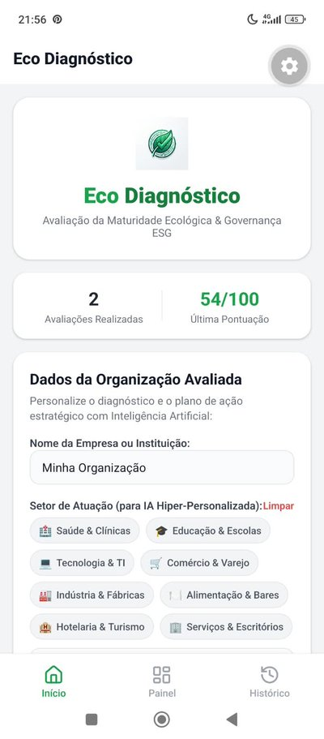
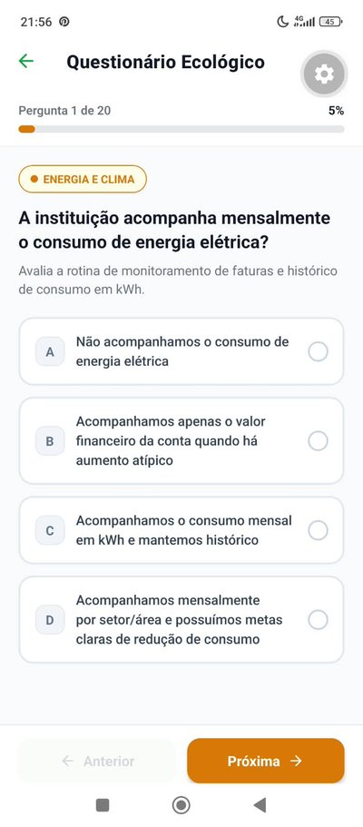
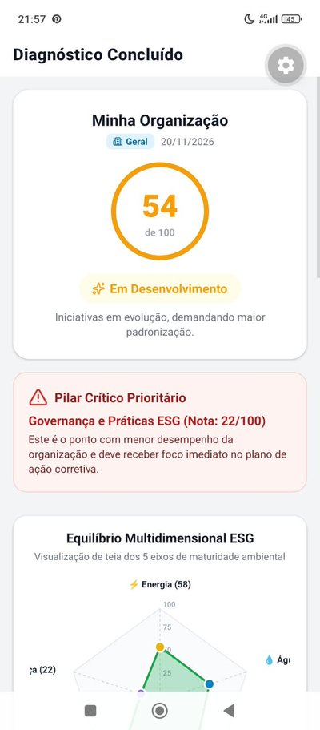
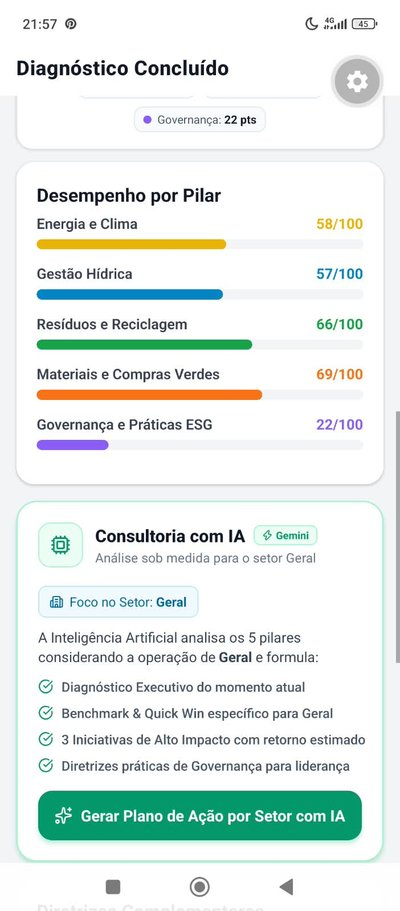
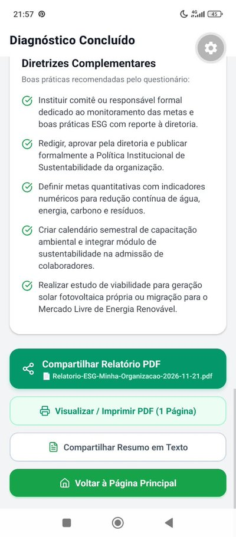
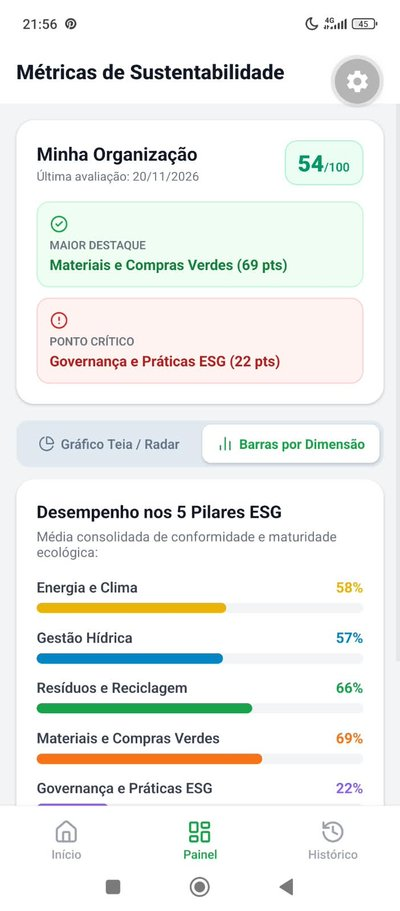
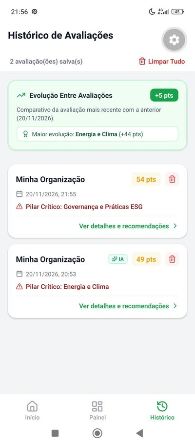

# 📱 Eco Diagnóstico Mobile — React Native (Expo)

> **Aplicativo Mobile Universitário para Diagnóstico de Sustentabilidade, Consultoria de IA e Governança Ecológica (ESG)**  
> Desenvolvido em **React Native com Expo e TypeScript**, com persistência local offline, geração de relatórios PDF executivos e consultoria automatizada.

---

## 🌟 Visão Geral do Aplicativo
O **Eco Diagnóstico Mobile** é um aplicativo nativo projetado para avaliar o nível de maturidade sustentável de empresas, instituições de ensino e organizações através de um questionário objetivo de **20 perguntas** distribuídas nas **5 dimensões ecológicas**:

1. ⚡ **Energia e Clima:** Eficiência energética, fontes renováveis, combate ao consumo em standby e automação.
2. 💧 **Gestão Hídrica:** Monitoramento de hidrômetros, dispositivos economizadores, captação pluvial e inspeção de vazamentos.
3. ♻️ **Resíduos e Reciclagem:** Coleta seletiva na fonte, compostagem de orgânicos, logística reversa e descarte de perigosos/eletrônicos.
4. 📦 **Materiais e Compras Verdes:** Banimento de plásticos descartáveis, digitalização (Paperless), homologação de fornecedores e produtos biodegradáveis.
5. 🏛️ **Governança e Práticas ESG:** Política ambiental formal, comitê responsável, capacitações periódicas e metas quantitativas.

---

## 📸 Telas do Aplicativo

Capturas reais do app rodando no Expo Go, em um celular Android:

<table>
  <tr>
    <td align="center"><br/><sub><b>Início</b><br/>organização e setor</sub></td>
    <td align="center"><br/><sub><b>Questionário</b><br/>20 perguntas, rascunho automático</sub></td>
    <td align="center"><br/><sub><b>Resultado</b><br/>nota, nível e pilar crítico</sub></td>
    <td align="center"><br/><sub><b>Consultoria com IA</b><br/>plano de ação por setor</sub></td>
  </tr>
  <tr>
    <td align="center"><br/><sub><b>Relatório PDF</b><br/>compartilhar ou imprimir</sub></td>
    <td align="center"><br/><sub><b>Painel ESG</b><br/>barras e radar por pilar</sub></td>
    <td align="center"><br/><sub><b>Histórico</b><br/>evolução entre avaliações</sub></td>
    <td></td>
  </tr>
</table>

---

## 🏗️ Funcionalidades e Arquitetura

* **Framework Base:** [React Native](https://reactnative.dev/) com [Expo](https://expo.dev/) (SDK 58)
* **Linguagem:** TypeScript
* **Identidade Visual:** Ícone do app, splash screen e identidade da organização [eco-diagnostic](https://github.com/eco-diagnostic).
* **Navegação Mobile:** [Expo Router](https://docs.expo.dev/router/introduction/) (rotas baseadas em arquivos na pasta `app/`)
  * `app/(tabs)/` → abas inferiores: Início (`/`), Painel ESG (`/dashboard`) e Histórico (`/history`)
  * `app/quiz.tsx` → questionário (`/quiz`, recebe organização e setor por parâmetros de rota)
  * `app/result.tsx` → resultado (`/result?id=<id>`, carrega o diagnóstico salvo pelo id)
  * `usePreventRemove` protege a saída do questionário (salvar rascunho ou descartar)
* **Persistência de Dados (Offline):** `@react-native-async-storage/async-storage` com salvamento automático de rascunho de questionário (`Draft`).
* **Visualização Gráfica:** Gráfico de Radar SVG interativo (`RadarChart`) e gráficos de barras por pilar.
* **Inteligência Artificial (Consultoria ESG):** Integração para diagnóstico executivo, geração de matriz de impacto x esforço e plano de ação setorial.
* **Exportação & Compartilhamento:**
  * Geração de relatório formal em **PDF** executivo com layout A4 (`expo-print`).
  * Compartilhamento direto via WhatsApp, E-mail e redes com a `Share API` nativa e `expo-sharing`.
* **Experiência Nativa:** Safe Area Insets, feedback tátil (`expo-haptics`), efeitos sonoros curtos (`expo-audio`, com botão de mudo no cabeçalho que respeita o modo silencioso) e proteção de saída acidental no questionário (`usePreventRemove`).
* **Biometria opcional (`expo-local-authentication`):** depois que a pessoa entra no app, ele oferece uma única vez proteger os diagnósticos com digital ou rosto. Fica desligada por padrão e pode ser ligada ou desligada no cartão "Proteger com biometria" da tela Início. Com a proteção ligada, o app abre numa tela de bloqueio. Só funciona em celular físico com biometria cadastrada (no iPhone, o Face ID não funciona dentro do Expo Go).
* **Cálculo de Maturidade:**
  * **0 a 39 pts:** Nível Crítico
  * **40 a 69 pts:** Em Desenvolvimento
  * **70 a 89 pts:** Nível Avançado
  * **90 a 100 pts:** Nível Sustentável
  * Detecção automática do **Pilar Crítico** prioritário e recomendações personalizadas.

---

## 🚀 Como Executar o Projeto no Celular

### 1. Pré-requisitos
* Ter o aplicativo gratuito **Expo Go** instalado no seu smartphone:
  * [Download no Google Play (Android)](https://play.google.com/store/apps/details?id=host.exp.exponent)
  * [Download na App Store (iOS)](https://apps.apple.com/app/expo-go/id982107779)

### 2. Configurar a Chave da IA (Google Gemini)
A consultoria com IA usa a API do Google Gemini. Sem a chave, o restante do app funciona normalmente, mas o botão de IA exibe "Chave de API do Gemini não configurada".

1. Gere uma chave gratuita no [Google AI Studio](https://aistudio.google.com/apikey).
2. Copie o arquivo `.env.example` para `.env` (na raiz do projeto) e preencha:
   ```
   EXPO_PUBLIC_GEMINI_API_KEY=sua_chave_aqui
   ```
3. Se o servidor já estiver rodando, reinicie com o cache limpo: `npx expo start --clear`.

> O `.env` está no `.gitignore` e não vai para o GitHub nem para o build do EAS. Para gerar o APK com a IA funcionando, cadastre a mesma variável em **expo.dev → projeto → Environment variables** (ambiente *preview*).

### 3. Iniciar o Servidor de Desenvolvimento
Na raiz do projeto:

```bash
npm install
npx expo start
```
> **Dica para redes móveis (4G/5G) ou redes Wi-Fi separadas:** Use o túnel para conectar de qualquer lugar:
> ```bash
> npx expo start --tunnel
> ```
> No SDK 58 o túnel padrão exige login no Expo (`npx expo login`). Sem conta, use o túnel alternativo: `npx expo start --tunnel ngrok`.
>
> **Versão do Expo Go:** o aplicativo Expo Go precisa ser da mesma versão do SDK do projeto (SDK 58). Se aparecer "Project is incompatible with this version of Expo Go", atualize o Expo Go.

### 4. Abrir no Celular
* **Android:** Abra o aplicativo **Expo Go** e toque em **"Scan QR Code"** para apontar a câmera para o QR Code no terminal.
* **iPhone:** Abra a câmera nativa do iOS, aponte para o QR Code e toque no banner do Expo.

---

## 📦 Como Gerar o Arquivo .APK do Android

Para gerar o arquivo instalável `.apk`:

### Opção 1: Via EAS Build (Nuvem da Expo - Gratuito e Recomendado)
1. Instale o CLI do EAS:
   ```bash
   npm install -g eas-cli
   ```
2. Faça login na sua conta Expo:
   ```bash
   eas login
   ```
3. Gere o arquivo APK com o comando:
   ```bash
   eas build -p android --profile preview
   ```
4. Ao concluir, o terminal exibirá o link direto para download do `.apk` compilado.

### Opção 2: Pré-compilação Local (com Android Studio)
```bash
npx expo run:android
```

---

## 📂 Estrutura de Pastas

```
.
├── app/                    # Rotas (Expo Router): cada arquivo é uma tela
│   ├── _layout.tsx         # Pilha raiz de navegação
│   ├── (tabs)/             # Abas inferiores: index, dashboard, history
│   ├── quiz.tsx            # Rota do questionário
│   └── result.tsx          # Rota do resultado
├── assets/                 # Ícone oficial, splash screen e imagens
├── src/
│   ├── assets/             # Assets embutidos para relatórios
│   ├── components/         # Componentes visuais (RadarChart, etc.)
│   ├── config/             # Configurações de serviços e IA
│   ├── data/
│   │   └── questions.ts    # 20 perguntas calibradas dos 5 pilares
│   ├── screens/            # Telas (as rotas em app/ apenas as exportam)
│   │   ├── HomeScreen.tsx      # Início, identificação e seleção de setor
│   │   ├── QuizScreen.tsx      # Questionário com rascunho automático
│   │   ├── ResultScreen.tsx    # Resultado, Radar, Consultoria IA e Exportação PDF
│   │   ├── DashboardScreen.tsx # Painel comparativo e estatísticas
│   │   └── HistoryScreen.tsx   # Histórico completo de diagnósticos offline
│   ├── services/
│   │   ├── aiService.ts    # Consultoria e planos de ação ESG com IA
│   │   ├── calc.ts         # Motor de cálculo e regras de negócio
│   │   ├── pdfReport.ts    # Gerador de relatório executivo em PDF
│   │   └── storage.ts      # Armazenamento e rascunhos no AsyncStorage
│   └── types/
│       └── index.ts        # Interfaces e modelos de dados TypeScript
├── app.json                # Configurações do Expo e pacote Android
├── eas.json                # Perfil de geração de APK Android
└── package.json            # Dependências React Native
```
